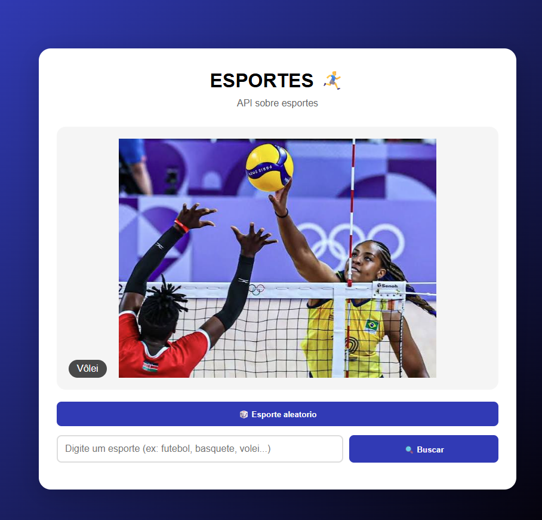
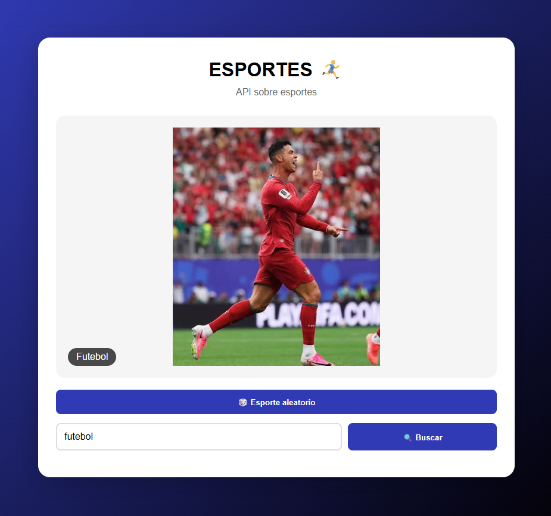
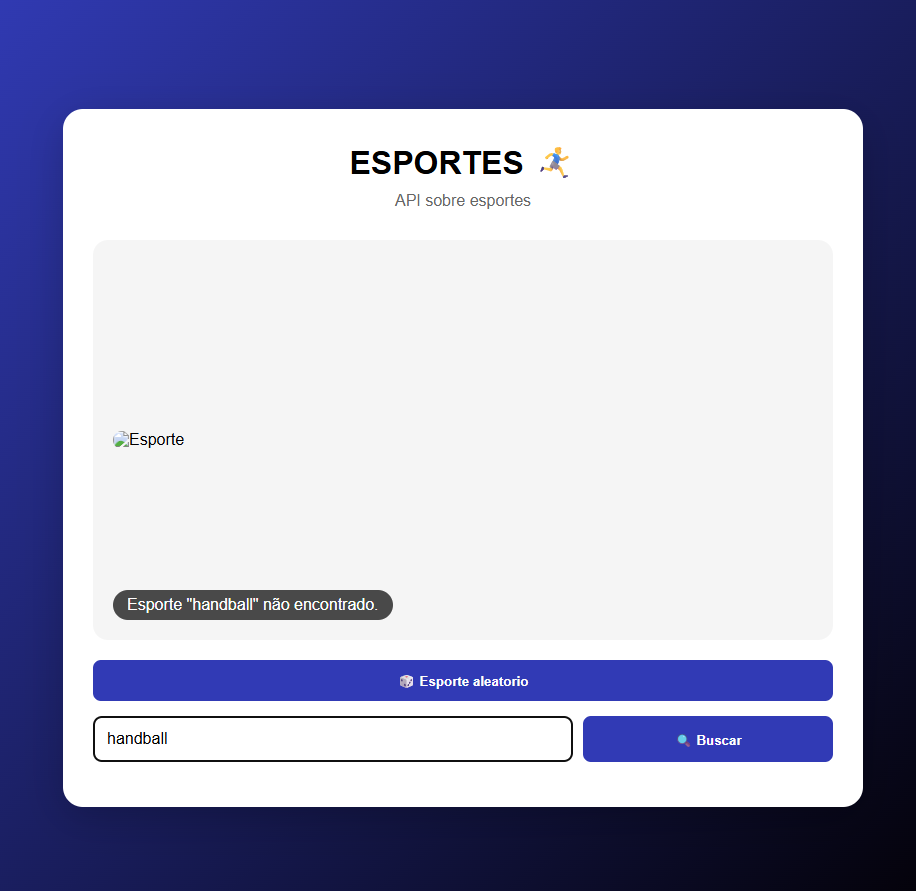

# 🏆 API de Esportes

A API de Esportes é um projeto desenvolvido com **Node.js e Express** que permite consultar imagens de diferentes modalidades esportivas.  
É possível sortear uma imagem aleatória ou buscar uma imagem de acordo com o esporte escolhido, por meio de uma interface simples e interativa.

## 🚀 Como executar o projeto

### 1. Instale as dependências

Abra o terminal na pasta do projeto e execute:

```bash
npm install
```

### 2. Inicie o servidor

```bash
node server.js
```

O servidor será iniciado em `http://localhost:3000`.

### 3. Abra a interface

Abra o arquivo `index.html` no navegador para utilizar a aplicação. Mantenha o servidor ligado enquanto estiver usando o site.

## 🔗 Rotas da API

| Método | Rota | Descrição |
|---|---|---|
| GET | `/api/esportes/aleatorio` | Retorna uma imagem aleatória de qualquer esporte cadastrado. |
| GET | `/api/esportes/:nome` | Retorna uma imagem aleatória da categoria informada. |

### Exemplos de requisições

- `http://localhost:3000/api/esportes/aleatorio`
- `http://localhost:3000/api/esportes/futebol`
- `http://localhost:3000/api/esportes/basquete`

Se uma categoria não existir, a API retorna o status HTTP `404` com uma mensagem de erro.

## ⚽ Categorias disponíveis

- ⚽ Futebol
- 🏐 Vôlei
- 🏀 Basquete
- 🏄 Surfe

Cada categoria deve possuir três imagens `.jpg` na pasta correspondente dentro de `data/fotos/`.

## 🛠️ Tecnologias utilizadas

- Node.js
- Express
- CORS
- HTML5
- CSS3
- JavaScript
- JSON

## 📸 Prints do projeto

### 1. Imagem aleatória


### 2. Busca por categoria


### 3. Mensagem de erro


## 👨‍💻 Autor

**Nome completo:** João Gabriel Dantas  
**Turma:** DSI1-SESI